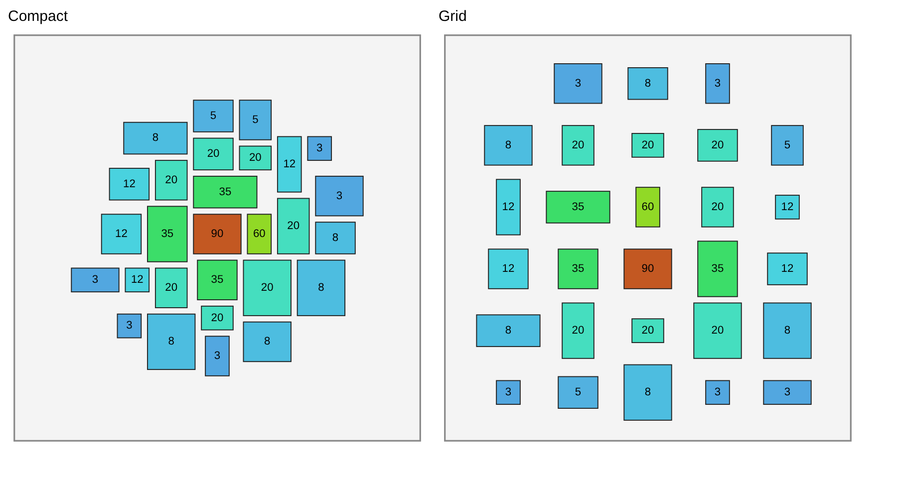

# Arrange by Height for OrcaSlicer

An OrcaSlicer plugin that arranges each build plate by object height. It adds an
**Arrange by Height** tab to the top bar, next to Prepare and Preview.


- **Tallest objects in the center.** Shorter objects are placed around them. Once the short
  objects are finished, the upper layers only visit the center of the plate, so travel moves
  are short.
- **Object list from shortest to tallest**, per plate. With print sequence **By object**,
  OrcaSlicer prints in object list order, so tall objects print last.
- **Spacing**: Auto, or a fixed distance in mm.
- **Layout**: Compact (packed around the tallest object) or Grid (equal cells, tallest objects
  in the center cells).
- **Plates**: keep each object on its plate, or regroup all objects so objects of similar
  height share a plate.
- **Align to Y axis**: turns long objects so their long side runs along Y, for bedslinger
  printers such as the Bambu Lab A1. Auto turns it on when the printer structure is i3, as
  OrcaSlicer's own arrange does.
- **Preview** of every plate after arranging, colored by height.



## How It Works

The OrcaSlicer plugin API can read the model but cannot move objects or change plates. The
plugin therefore:

1. Exports a copy of the open project, unsaved changes included.
2. Arranges the copy.
3. Writes a new project file, `<project>-arranged.3mf` by default.

Open the new file with **File > Open Project**. The original project is not changed.

## Requirements

An OrcaSlicer build with the **File > Plugins** menu (the Python plugin system). The plugin
uses only the Python standard library.

## Install

1. Download [`arrange_by_height/arrange_by_height.py`](arrange_by_height/arrange_by_height.py).
2. In OrcaSlicer, open **File > Plugins**.
3. Click the arrow next to **Browse plugins**, then **Install local plugin**.
4. Select `arrange_by_height.py`.
5. Check **Activate** for **Arrange by Height**.

To install by hand instead, copy the file to `orca_plugins/arrange_by_height/` in the
OrcaSlicer data folder:

| System | Data folder |
|---|---|
| Windows | `%APPDATA%\OrcaSlicer` |
| macOS | `~/Library/Application Support/OrcaSlicer` |
| Linux | `~/.config/OrcaSlicer` |

## Use

1. Click the **Arrange by Height** tab in the top bar.
2. Choose the settings and the output file, then click **Arrange**.
3. On the first run, OrcaSlicer asks to allow the plugin to write files. Allow it.
4. Check the preview, then open the output file with **File > Open Project**.

The settings are saved for the next run. If the tab is not shown, check **Preferences >
General > Plugins > Visible plugin pages**: further plugin tabs collapse into a dropdown on
the last plugin tab.

### Spacing

| Setting | Gap between objects |
|---|---|
| Auto, print sequence By layer | brim width + brim-object gap on each side, at least 2 mm |
| Auto, print sequence By object | extruder clearance radius (4 mm when every object is lower than the nozzle height) |
| Manual | the value entered, in mm |

These are the same rules OrcaSlicer's own Auto Arrange uses. A plate with its own print
sequence uses that print sequence. When a brim is on, objects also keep a brim width from
the bed edge.

### Align to Y Axis

| Setting | Effect |
|---|---|
| Auto | on when the printer structure is i3 (bedslinger), off otherwise |
| On | always turn long objects along Y |
| Off | keep each object's rotation |

On a bedslinger the bed moves in Y. A part whose long side runs along Y is pushed along its
length, so it is less likely to wobble or come loose. Each object is turned about its own
vertical axis by the same rule OrcaSlicer uses: the long axis of its outline seen from above.
Objects that are close to square (axis ratio above 0.66) are not turned.

Align to Y axis reads the object geometry from the project file, so it takes longer on
projects with large meshes.

### Plates

- **Keep objects on their plates**: each plate is arranged with the objects already on it.
  Objects that no longer fit move to new plates at the end.
- **Regroup plates by height**: all objects are sorted tallest first and fill plate 1, then
  plate 2, and so on. Objects of similar height end up on the same plate.

## Command Line

The same file runs without OrcaSlicer, on a saved project:

```bash
python arrange_by_height.py project.3mf
```

```bash
python arrange_by_height.py project.3mf -o out.3mf --spacing 5 --layout grid --plates regroup --align-y on
```

From the command line the plugin reads the object geometry from the 3MF, which is slower for
large meshes. Inside OrcaSlicer it uses the sizes from the open model.

## Limits

- Objects are placed by their bounding box, not their outline. Apart from Align to Y axis,
  they are not rotated. Round or L-shaped parts use more space than with OrcaSlicer's own
  arrange.
- The prime tower is not considered. On multi-material plates, check that no object
  overlaps the prime tower, or move the tower.
- With print sequence By object, OrcaSlicer checks the gantry clearance. If more than one
  object is taller than **Height to rod**, OrcaSlicer may report a collision; move one of
  them to another row or plate.
- Plate thumbnails and sliced results in the output file are cleared. Slice again after
  opening it.

## Tests

```bash
python -m unittest discover -s tests
```
