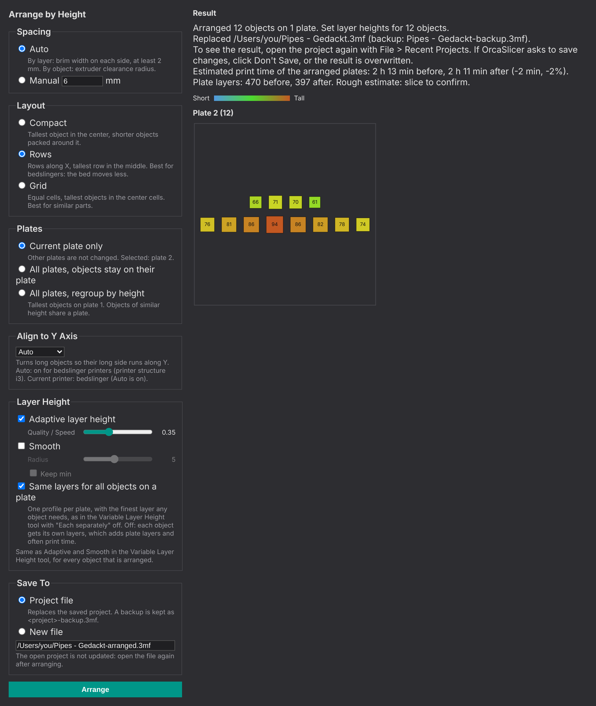

# Arrange by Height for OrcaSlicer

An OrcaSlicer plugin that arranges build plates by object height. It adds an **Arrange**
tab to the top bar, next to Prepare and Preview.




- **Tallest objects in the center.** Shorter objects are placed around them. Once the short
  objects are finished, the upper layers only visit the center of the plate, so travel moves
  are short.
- **Object list from shortest to tallest**, per plate. With print sequence **By object**,
  OrcaSlicer prints in object list order, so tall objects print last.
- **Spacing**: Auto, or a fixed distance in mm.
- **Layout**: Compact (packed around the tallest object), Rows (rows along X, tallest row
  in the middle; best for bedslingers) or Grid (equal cells, tallest objects in the center
  cells).
- **Plates**: the selected plate only, every plate with objects kept on their plate, or
  every plate regrouped so objects of similar height share a plate.
- **Layer height**: Adaptive layer height (Quality / Speed slider) and Smooth (Radius
  slider, Keep min) for every arranged object, as in the Variable Layer Height tool.
- **Save to** the project file (a backup is kept) or a new file.
- **Align to Y axis**: turns long objects so their long side runs along Y, for bedslinger
  printers such as the Bambu Lab A1. Auto turns it on when the printer structure is i3, as
  OrcaSlicer's own arrange does.
- **Preview** of every plate after arranging, colored by height.


## How It Works

The OrcaSlicer plugin API can read the model but cannot move objects or change plates. The
plugin therefore:

1. Exports a copy of the open project, unsaved changes included.
2. Arranges the copy.
3. Writes it over the project file, or to a new file.

The open window is not updated. Open the file again to see the result.

## Requirements

An OrcaSlicer build with the **File > Plugins** menu (the Python plugin system). The plugin
uses only the Python standard library.

## Install

1. Download [`arrange_by_height/arrange_by_height.py`](arrange_by_height/arrange_by_height.py).
2. In OrcaSlicer, open **File > Plugins**.
3. Click the arrow next to **Browse plugins**, then **Install local plugin**.
4. Select `arrange_by_height.py`.
5. Check **Activate** for **Arrange by Height**.

To install by hand instead, copy the file to `orca_plugins/arrange_by_height/` in the
OrcaSlicer data folder:

| System | Data folder |
|---|---|
| Windows | `%APPDATA%\OrcaSlicer` |
| macOS | `~/Library/Application Support/OrcaSlicer` |
| Linux | `~/.config/OrcaSlicer` |

## Use

1. In **Prepare**, select the plate to arrange.
2. Click the **Arrange** tab in the top bar.
3. Choose the settings, then click **Arrange**.
4. On the first run, OrcaSlicer asks to allow the plugin to write files. Allow it.
5. Check the preview, then open the project again:
   - **Save to: Project file**: **File > Recent Projects**, then your project. If
     OrcaSlicer asks to save changes, click **Don't Save**. Saving would write the old
     arrangement back over the new one.
   - **Save to: New file**: **File > Open Project**, then `<project>-arranged.3mf`.

The settings are saved for the next run. If the tab is not shown, check **Preferences >
General > Plugins > Visible plugin pages**: further plugin tabs collapse into a dropdown on
the last plugin tab.

### Spacing

| Setting | Gap between objects |
|---|---|
| Auto, print sequence By layer | brim width + brim-object gap on each side, at least 2 mm |
| Auto, print sequence By object | extruder clearance radius (4 mm when every object is lower than the nozzle height) |
| Manual | the value entered, in mm |

These are the same rules OrcaSlicer's own Auto Arrange uses. A plate with its own print
sequence uses that print sequence. When a brim is on, objects also keep a brim width from
the bed edge.

### Align to Y Axis

| Setting | Effect |
|---|---|
| Auto | on when the printer structure is i3 (bedslinger), off otherwise |
| On | always turn long objects along Y |
| Off | keep each object's rotation |

On a bedslinger the bed moves in Y. A part whose long side runs along Y is pushed along its
length, so it is less likely to wobble or come loose. Each object is turned about its own
vertical axis by the same rule OrcaSlicer uses: the long axis of its outline seen from above.
Objects that are close to square (axis ratio above 0.66) are not turned.

Align to Y axis reads the object geometry from the project file, so it takes longer on
projects with large meshes.

### Layout

| Layout | Placement | Use for |
|---|---|---|
| Compact | tallest object in the center, shorter objects packed around it | mixed parts |
| Rows | rows along X, tallest row in the middle, tallest object in the middle of each row | bedslingers: the bed moves in Y, so it moves less between parts in a row |
| Grid | equal cells, tallest objects in the center cells | many similar parts |

### Layer Height

| Setting | Effect |
|---|---|
| Adaptive layer height | thin layers on shallow slopes, thick layers on steep walls |
| Quality / Speed | 0 = thinnest layers (quality) to 1 = thickest layers (speed); default 0.5 |
| Smooth | evens out sudden changes in layer height |
| Radius | 1 to 10 layers; larger is smoother; default 5 |
| Keep min | smoothing never makes a layer thicker than before |
| Same layers for all objects on a plate | one profile per plate (on by default) |

These use the same algorithms as **Adaptive** and **Smooth** in OrcaSlicer's Variable Layer
Height tool, with the layer height, first layer height, and min / max layer height from your
printer and process settings (and each object's own layer height, if set). They apply to
every object that is arranged: on **Current plate only**, the objects on that plate.
Height range modifiers keep their layer height.

**Same layers for all objects on a plate** gives every object on the plate one profile,
with the finest layer any of them needs at each height, as the Variable Layer Height tool
does with **Each separately** off. OrcaSlicer prints a plate layer by layer: when each
object has its own profile, their layers fall at different heights, so the plate gets many
more layers. Each extra layer adds a layer change, and short layers trigger the minimum
layer time for cooling, which can double the print time of a plate of small parts. Objects
whose first layer differs (a raft, another first layer height) keep their own profile. With
the setting off, **Smooth** without **Adaptive** smooths only objects that have a profile.

### Print Time Estimate

After arranging, the result shows an estimated print time of the arranged plates before and
after, and their number of plate layers. The estimate cuts each object's mesh at every
layer and adds up walls and infill at the speeds in your settings (capped by the filament's
maximum volumetric speed), travel between objects, retractions, layer changes and the
minimum layer time. It leaves out acceleration, supports, bridges and the purge, so the
absolute times are lower than OrcaSlicer's; use it to compare before and after, and slice
to confirm.

To check the result, select an object and open the Variable Layer Height tool after
opening the project again.

### Plates

- **Current plate only**: only the plate selected in Prepare is arranged. Other plates, and
  their place in the object list, are not changed.
- **All plates, objects stay on their plate**: each plate is arranged with the objects
  already on it.
- **All plates, regroup by height**: all objects are sorted tallest first and fill plate 1,
  then plate 2, and so on. Objects of similar height end up on the same plate.

In every mode, objects that no longer fit move to new plates at the end.

### Save To

- **Project file**: replaces the saved project file. The previous file is kept as
  `<project>-backup.3mf` next to it (overwritten on the next run). The project must be
  saved once first.
- **New file**: writes to the path in the box, `<project>-arranged.3mf` by default.

## Command Line

The same file runs without OrcaSlicer, on a saved project:

```bash
python arrange_by_height.py project.3mf
```

```bash
python arrange_by_height.py project.3mf -o out.3mf --spacing 5 --layout rows --plates current --plate 2 --align-y on --adaptive 0.35 --smooth 5 --each-separately
```

From the command line the plugin reads the object geometry from the 3MF, which is slower for
large meshes. Inside OrcaSlicer it uses the sizes from the open model.

## Limits

- Objects are placed by their bounding box, not their outline. Apart from Align to Y axis,
  they are not rotated. Round or L-shaped parts use more space than with OrcaSlicer's own
  arrange.
- The prime tower is not considered. On multi-material plates, check that no object
  overlaps the prime tower, or move the tower.
- With print sequence By object, OrcaSlicer checks the gantry clearance. If more than one
  object is taller than **Height to rod**, OrcaSlicer may report a collision; move one of
  them to another row or plate.
- Plate thumbnails and sliced results in the output file are cleared. Slice again after
  opening it.

## Tests

```bash
python -m unittest discover -s tests
```
